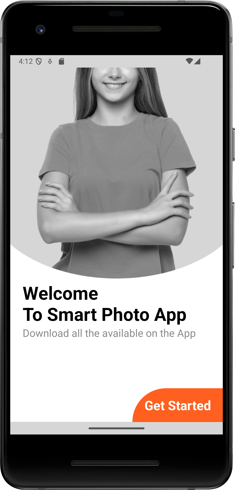
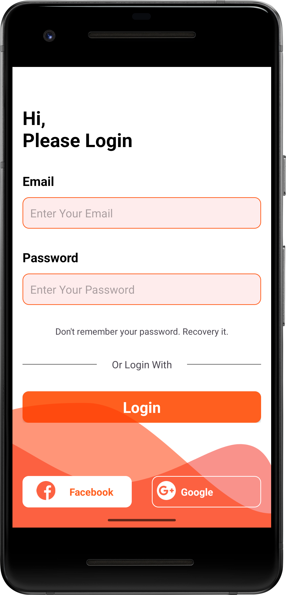
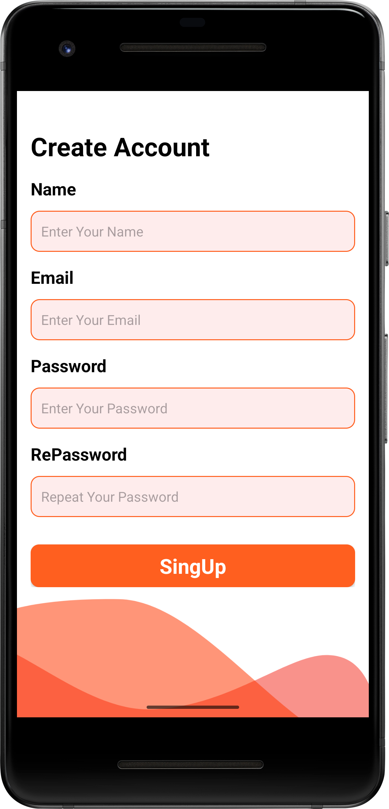
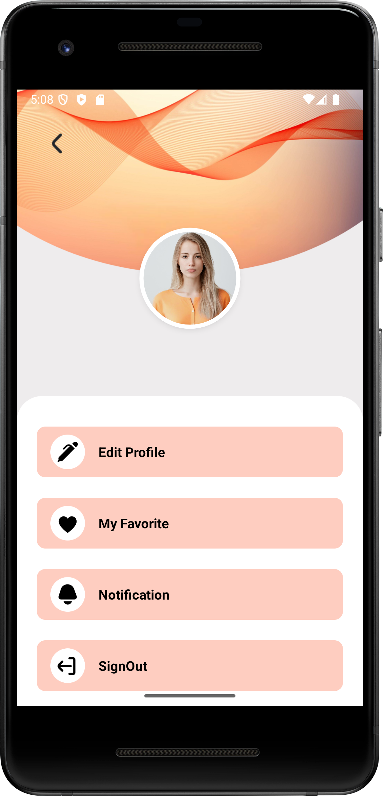

# Responsive Mobile App

Android uygulaması için karşılama, giriş, kayıt ve profil ekranı tasarımları içeren bir arayüz projesi.

## Ekran görüntüleri

| Karşılama | Giriş |
|---|---|
|  |  |

| Kayıt | Profil |
|---|---|
|  |  |

## Gereksinimler

- Android Studio
- Android SDK (proje `compileSdk` 35 kullanır)
- Android Emulator veya USB hata ayıklaması etkin bir Android cihaz

## Çalıştırma

1. Projeyi Android Studio'da açın.
2. Gradle senkronizasyonunun tamamlanmasını bekleyin.
3. Bir emülatör başlatın veya Android cihazınızı bağlayın.
4. **Run** düğmesine basın.

Komut satırından debug APK oluşturmak için proje kökünde:

```bash
bash ./gradlew :app:assembleDebug
```

APK şu konumda oluşturulur:

```text
app/build/outputs/apk/debug/app-debug.apk
```

## Mevcut durum

- Uygulama açıldığında karşılama ekranı gösterilir.
- **Get Started** düğmesi giriş ekranına geçirir.
- Kayıt ve profil ekranları tasarım dosyaları olarak projede bulunur; kayıt, oturum açma, sosyal giriş veya profil işlemleri henüz uygulama mantığına bağlanmamıştır.

## Teknolojiler

- Java
- Android SDK
- AndroidX AppCompat ve ConstraintLayout
- Material Components
